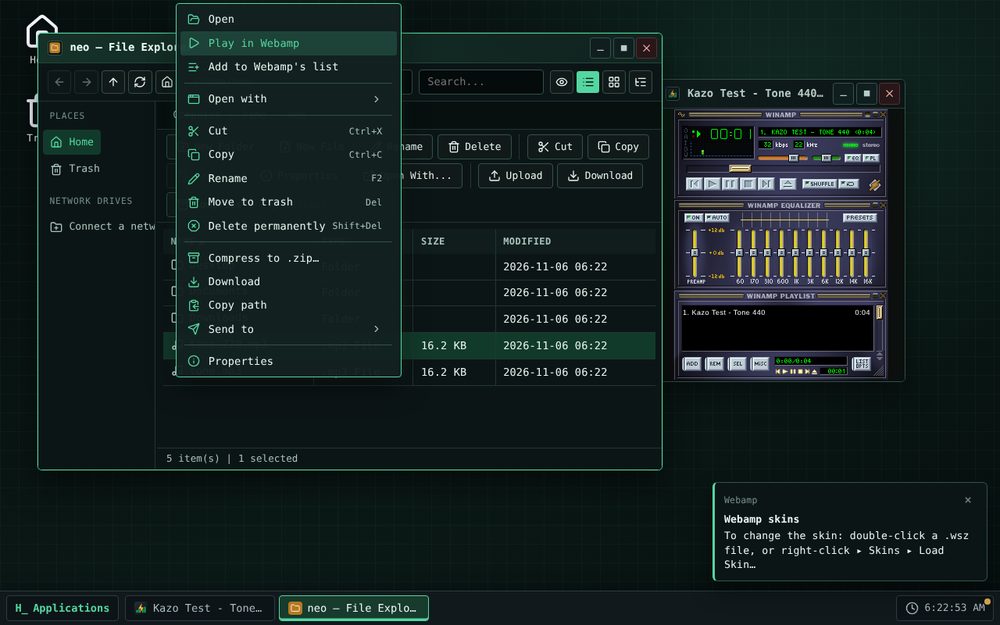
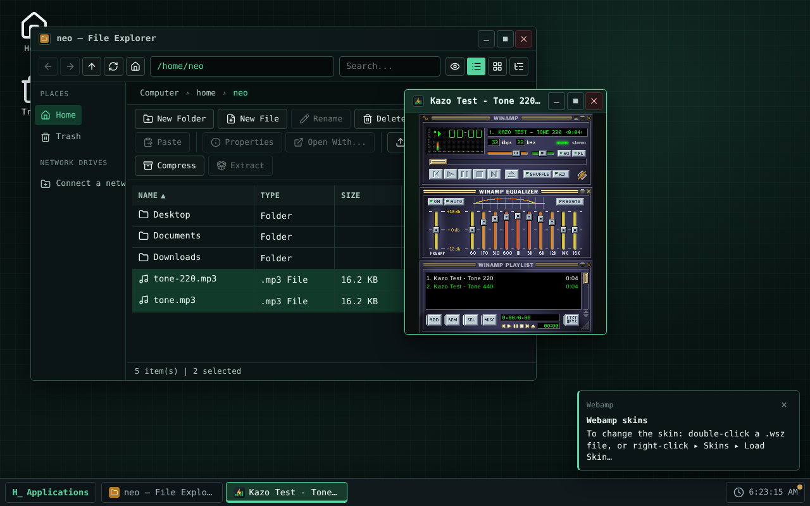
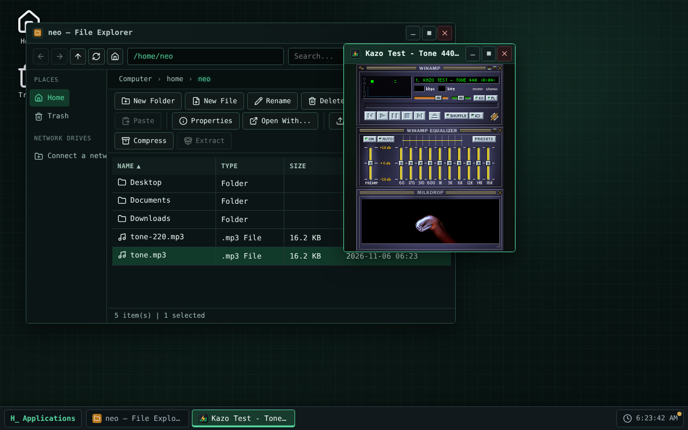

> [Version française](readme-fr.md)

<!-- Store listing: the same text as store/description.en.md and the same screenshots as the Kazo OS Store (store/screenshots/). Change them together. -->


# Webamp

Winamp 2's music player, in a Kazo OS window. Built on [Webamp](https://github.com/captbaritone/webamp)
by Jordan Eldredge: player, equalizer, playlist and the Milkdrop visualizer, as back in the day.

## Play your files

- **Double-click a music file** in the File Explorer: it is added to the list and plays. Webamp
  plays `.mp3`, `.wav`, `.ogg`, `.oga`, `.opus`, `.flac`, `.m4a`, `.aac` and `.weba`.
- Right-click files or a **folder**: "Play in Webamp" or "Add to Webamp's list" (a folder adds its
  music and the music of its subfolders, sorted by path).
- Webamp's "Open", "Add file" and "Add dir" show the Kazo OS dialogs.
- One window: what you open is added to the current list.
- **Network drives** too: music, lists and folders of a folder of your computer mounted in Kazo OS
  (`/mnt/<name>`, Chrome and Edge on a computer) open like your own files.

## Playlists

- Open `.m3u`, `.m3u8` and `.pls` lists (relative paths included); save yours as `.m3u8` with
  "Save list".

## Skins

To change the skin: **double-click a `.wsz` file**, or **right-click ▸ Skins ▸ Load Skin…** in
Webamp. The skin is applied and kept in `~/.local/share/webamp/skins/`: it then shows in the Skins
menu. A notification says so on the first launch.

## Also

- Webamp comes back as you left it: list, track and position, volume, balance, equalizer, skin, the
  place of its windows and double size.
- The window's title follows the track ("Artist - Title - Webamp"); the keyboard's media keys work.
- Webamp's shortcuts only act while its window has the focus.
- Webamp's minimize button minimizes its Kazo OS window; the music keeps playing.
- **Milkdrop** (Butterchurn, 2 MB) is downloaded only when its window first opens.

## Limits of the first version

- Desktop only (no phone version).
- No music from the internet ("Add URL" is hidden).
- Needs Kazo OS 3.1.0 or later.

## Licenses

Webamp (the app) is free software under the MIT license. It bundles Webamp 2.3.1 (MIT), Butterchurn
and its presets (MIT). The default skin is the **Winamp 2.91 base skin**, as Webamp distributes it:
its artwork is Nullsoft's and not under MIT (see `THIRD-PARTY-NOTICES.md` in the repository). No
community skin is included.

## Screenshots

<p>
  
  
  
</p>

<!-- /Store listing -->

## Try it

<!-- "Open in Kazo OS" link: https://os.kazo.ca/?autolaunch=ca.kazo.webamp goes here once Kazo OS supports it. -->

Open [Kazo OS](https://os.kazo.ca/) and install Webamp from the **Kazo OS Store** (category Music and video), or in the Kazo OS Terminal, as an administrator: `sudo kazopkg install Kazo-ca/Os-App-Webamp`.

## About Kazo OS

[Kazo OS](https://github.com/Kazo-ca/Os) is a simulated operating system that runs in the browser, written in C# with Blazor WebAssembly. It gives a complete environment to build and run applications: desktop and windows, a persistent file system, processes, a POSIX shell, a simulated network, the Kazo OS Store, and a public SDK (NuGet packages) to make apps such as this one. Try it at <https://os.kazo.ca/> (PWA, works offline).

## Development

- Plan: [English](doc/en/plan.md) · [Français](doc/fr/plan.md)
- Architecture: [English](doc/en/architecture.md) · [Français](doc/fr/architecture.md)
- License: MIT ([LICENSE](LICENSE)); bundled works and the default skin: [THIRD-PARTY-NOTICES.md](THIRD-PARTY-NOTICES.md).

### Build and run

The repository was made with the Kazo OS `kazoos-solution` template, now on Kazo OS 3.1.0
(`external/KazoOs`, a submodule on the `v3.1.0` tag).

```bash
git clone --recurse-submodules https://github.com/Kazo-ca/Os-App-Webamp.git
cd Os-App-Webamp
dotnet run --project src/Kazo.Webamp.Os      # Kazo OS with Webamp, on http://localhost:5290
```

`Debug` builds Kazo OS from the submodule's sources; `Release` uses the `Kazo.Os.*` packages of
nuget.org, at the submodule's version. Never modify the submodule: CI refuses it.

### Tests

```bash
dotnet build Kazo.Webamp.slnx -c Release
dotnet test Kazo.Webamp.slnx -c Release --no-build   # C# (xUnit)
npm ci
npm test                                            # the JavaScript module (node --test)
npm run test:e2e                                    # Webamp inside the Kazo OS host (Playwright, Chromium)
npm run test:installed -- <Kazo OS wwwroot> <packages>   # Webamp installed by kazopkg in the trimmed OS
npm run store:screenshots                           # the Kazo OS Store screenshots (store/screenshots)
```

`test:installed` needs a Kazo OS publish (`dotnet publish external/KazoOs/wasm2/KazoOs/OS/Kazo.Os.Ecosystem -c Release`,
its `wwwroot`) and Webamp's package (`dotnet build src/Kazo.Webamp -c Release -t:KazoOsPack`, folder
`src/Kazo.Webamp/bin/kazoos-packages`). See [architecture](doc/en/architecture.md#kazo-os-store-listing-and-installed-app).
