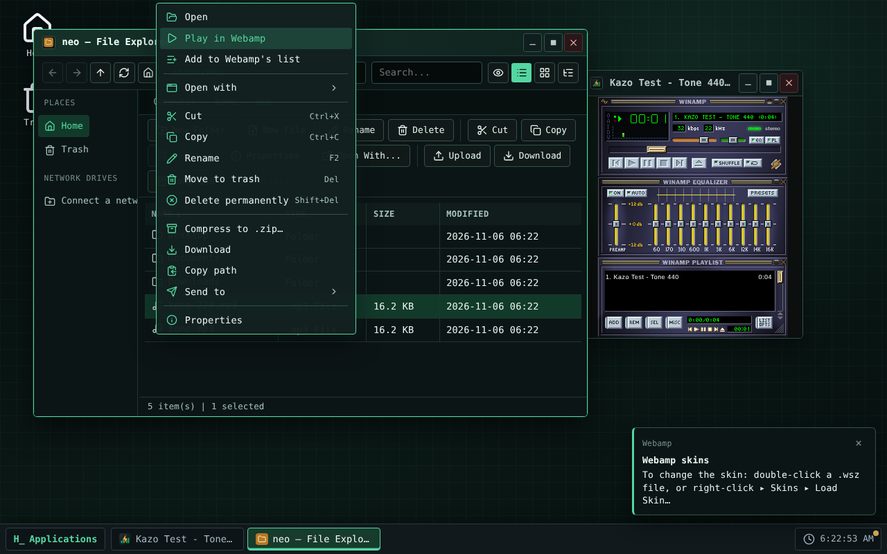
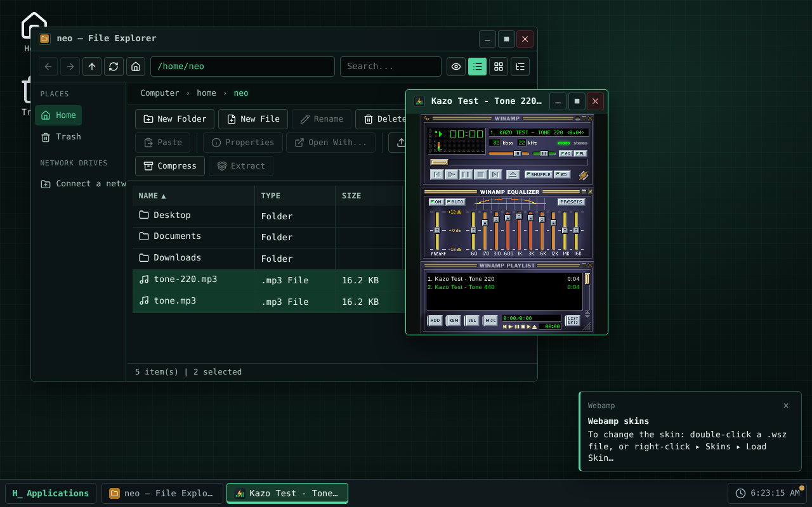
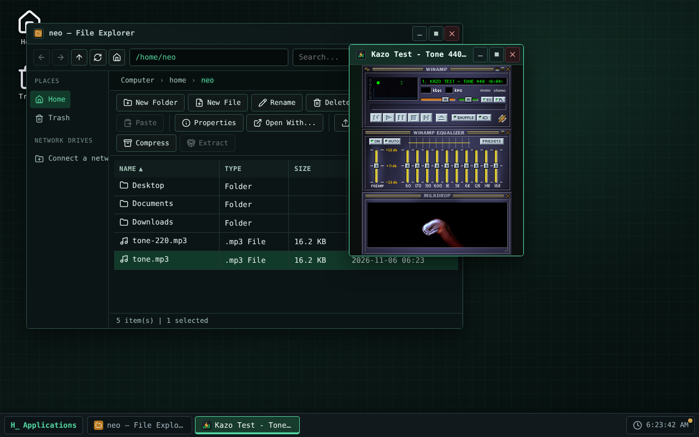

> [English version](README.md)

<!-- Fiche du Store : le même texte que store/description.fr.md et les mêmes captures que le Kazo OS Store (store/screenshots/). Les changer ensemble. -->


# Webamp

Le lecteur de musique de Winamp 2, dans une fenêtre de Kazo OS. Construit sur
[Webamp](https://github.com/captbaritone/webamp) de Jordan Eldredge : lecteur, égaliseur, liste de
lecture et visualisation Milkdrop, comme à l'époque.

## Écouter vos fichiers

- **Double-cliquez une musique** dans l'explorateur de fichiers : elle s'ajoute à la liste et joue.
  Webamp lit `.mp3`, `.wav`, `.ogg`, `.oga`, `.opus`, `.flac`, `.m4a`, `.aac` et `.weba`.
- Clic droit sur des fichiers ou un **dossier** : « Lire dans Webamp » ou « Ajouter à la liste de
  Webamp » (un dossier ajoute ses musiques et celles de ses sous-dossiers, triées par chemin).
- « Open », « Add file » et « Add dir » de Webamp ouvrent les dialogues de Kazo OS.
- Une seule fenêtre : ce que vous ouvrez s'ajoute à la liste en cours.
- Les **lecteurs réseau** aussi : les musiques, listes et dossiers d'un dossier de votre ordinateur
  monté dans Kazo OS (`/mnt/<nom>`, Chrome et Edge sur ordinateur) s'ouvrent comme vos fichiers.

## Listes de lecture

- Ouvrez des listes `.m3u`, `.m3u8` et `.pls` (chemins relatifs compris) ; enregistrez la vôtre en
  `.m3u8` par « Save list ».

## Skins

Pour changer de skin : **double-cliquez un fichier `.wsz`**, ou **clic droit ▸ Skins ▸ Load
Skin…** dans Webamp. Le skin est appliqué et gardé dans `~/.local/share/webamp/skins/` : il apparaît
ensuite dans le menu Skins. Une notification le rappelle au premier lancement.

## Et aussi

- Webamp reprend comme vous l'avez laissé : liste, morceau et position, volume, balance, égaliseur,
  skin, place de ses fenêtres et taille double.
- Le titre de la fenêtre suit le morceau (« Artiste - Titre - Webamp ») ; les touches multimédia du
  clavier fonctionnent.
- Les raccourcis de Webamp n'agissent que quand sa fenêtre a le focus.
- Le bouton réduire de Webamp réduit sa fenêtre de Kazo OS ; la musique continue.
- **Milkdrop** (Butterchurn, 2 Mo) n'est téléchargé qu'à la première ouverture de sa fenêtre.

## Limites de la première version

- Ordinateur seulement (pas de version téléphone).
- Pas de musique depuis internet (« Add URL » est masqué).
- Demande Kazo OS 3.1.0 ou plus récent.

## Licences

Webamp (l'app) est un logiciel libre sous licence MIT. Il embarque Webamp 2.3.1 (MIT), Butterchurn
et ses préréglages (MIT). Le skin par défaut est le **skin de base de Winamp 2.91**, tel que Webamp
le distribue : son dessin appartient à Nullsoft et n'est pas sous MIT (voir
`THIRD-PARTY-NOTICES.md` dans le dépôt). Aucun skin de la communauté n'est fourni.

## Captures d'écran

<p>
  
  
  
</p>

<!-- /Fiche du Store -->

## Essayer

<!-- Lien « Ouvrir dans Kazo OS » : https://os.kazo.ca/?autolaunch=ca.kazo.webamp va ici quand Kazo OS le prendra en charge. -->

Ouvrez [Kazo OS](https://os.kazo.ca/) et installez Webamp depuis le **Kazo OS Store** (catégorie Musique et vidéo), ou dans le Terminal de Kazo OS, en administrateur : `sudo kazopkg install Kazo-ca/Os-App-Webamp`.

## À propos de Kazo OS

[Kazo OS](https://github.com/Kazo-ca/Os) est un système d'exploitation simulé qui tourne dans le navigateur, écrit en C# avec Blazor WebAssembly. Il offre un environnement complet pour développer et exécuter des applications : bureau et fenêtres, système de fichiers persistant, processus, shell POSIX, réseau simulé, le Kazo OS Store, et un SDK public (paquets NuGet) pour créer des apps comme celle-ci. Essayez-le sur <https://os.kazo.ca/> (PWA, fonctionne hors ligne).

## Développement

- Plan : [Français](doc/fr/plan.md) · [English](doc/en/plan.md)
- Architecture : [Français](doc/fr/architecture.md) · [English](doc/en/architecture.md)
- Licence : MIT ([LICENSE](LICENSE)) ; œuvres incluses et skin par défaut : [THIRD-PARTY-NOTICES.md](THIRD-PARTY-NOTICES.md).

### Compiler et lancer

Le dépôt a été créé avec le modèle `kazoos-solution` de Kazo OS, aujourd'hui sur Kazo OS 3.1.0
(`external/KazoOs`, un sous-module sur le tag `v3.1.0`).

```bash
git clone --recurse-submodules https://github.com/Kazo-ca/Os-App-Webamp.git
cd Os-App-Webamp
dotnet run --project src/Kazo.Webamp.Os      # Kazo OS avec Webamp, sur http://localhost:5290
```

`Debug` compile Kazo OS depuis les sources du sous-module ; `Release` prend les paquets `Kazo.Os.*` de
nuget.org, à la version du sous-module. Ne modifiez jamais le sous-module : la CI le refuse.

### Tests

```bash
dotnet build Kazo.Webamp.slnx -c Release
dotnet test Kazo.Webamp.slnx -c Release --no-build   # C# (xUnit)
npm ci
npm test                                            # le module JavaScript (node --test)
npm run test:e2e                                    # Webamp dans l'hôte Kazo OS (Playwright, Chromium)
npm run test:installed -- <wwwroot de Kazo OS> <paquets>   # Webamp installé par kazopkg dans l'OS rogné
npm run store:screenshots                           # les captures du Kazo OS Store (store/screenshots)
```

`test:installed` demande une publication de Kazo OS (`dotnet publish external/KazoOs/wasm2/KazoOs/OS/Kazo.Os.Ecosystem -c Release`,
son `wwwroot`) et le paquet de Webamp (`dotnet build src/Kazo.Webamp -c Release -t:KazoOsPack`, dossier
`src/Kazo.Webamp/bin/kazoos-packages`). Voir l'[architecture](doc/fr/architecture.md#fiche-du-kazo-os-store-et-app-installée).
